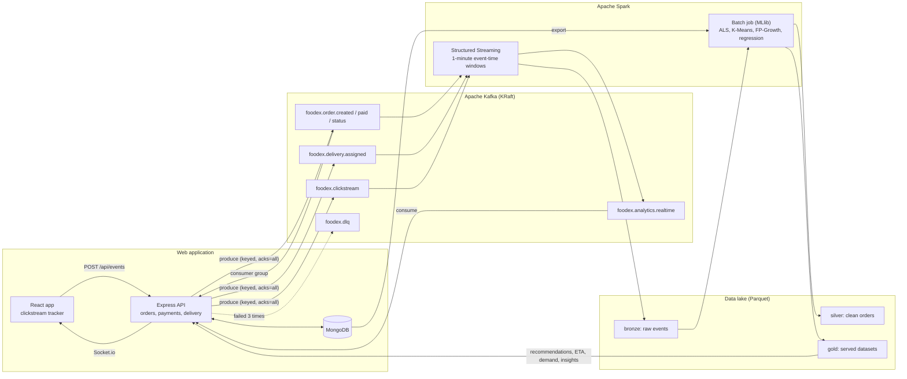
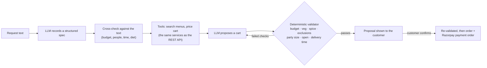

# Foodex

Full-stack food delivery platform for four kinds of user: customers, restaurant
owners, delivery riders and admins. React and Node.js on MongoDB, with
real-time order tracking over Socket.io, server-side pricing with coupons,
UPI-first Razorpay payments, an **LLM ordering agent** that turns a sentence into a
validated cart, and an event-driven big data pipeline behind it:
**Apache Kafka** for event streaming, **Apache Spark** (Structured Streaming
and MLlib) for real-time and batch analytics, and a bronze/silver/gold data lake.

```bash
cp .env.example .env    # fill in the two secrets
docker compose up -d --build
```

Then open http://localhost:3000 (demo logins below) and the API reference at
http://localhost:5000/api/docs.

## Architecture



How the pieces are used:

| Layer | What it does here | Code |
|---|---|---|
| **Kafka producers** | Every order, payment, status change, delivery assignment and browser click is published as a versioned JSON event, keyed by order or session so related events stay in order on one partition | `backend/src/kafka/`, `backend/src/services/orderService.js`, `frontend/src/services/tracker.js` |
| **Kafka consumers** | A consumer group sends notifications and assigns delivery partners. Handlers are retried, poison messages go to a dead-letter topic, and redelivered events are dropped by event id (at-least-once delivery with idempotent consumers) | `backend/src/kafka/index.js`, `eventHandlers.js` |
| **Spark Structured Streaming** | Reads the topics, aggregates orders, revenue, trending dishes and funnel stages in 1-minute event-time windows with a watermark, and publishes the results back to Kafka; also lands every raw event in the lake as Parquet | `backend/analytics/streaming_pipeline.py` |
| **Live dashboard** | The API consumes Spark's windows and pushes them to the admin page over Socket.io | `backend/src/services/realtimeMetricsService.js`, `frontend/src/pages/AdminPipelinePage.jsx` |
| **Spark batch + MLlib** | Cleans orders into a silver table, then builds ALS recommendations, K-Means customer segments (RFM), FP-Growth basket rules, a delivery-time regression and a demand forecast | `backend/analytics/batch_features.py` |
| **Serving** | The API reads the gold datasets: personalised restaurants on the home page, delivery ETA at checkout, demand per restaurant, and the insights section of the admin page | `backend/src/services/sparkOutputStore.js`, `analyticsService.js` |

The application does not depend on the pipeline being up. Without a broker,
events are dispatched to the same handlers inside the API process; without
Spark output, the analytics endpoints fall back to MongoDB aggregates. The admin
page states which path is active, so a number is never attributed to Spark when
Spark did not produce it.

## Tech stack

- **Frontend:** React 19, Vite, Tailwind CSS, Redux Toolkit, Recharts, Socket.io client
- **Backend:** Node.js, Express 5, Mongoose, Socket.io, GraphQL (Apollo), JWT auth, Bull queues
- **Streaming:** Apache Kafka 3.9 (KRaft), kafkajs
- **Processing:** Apache Spark 3.5 (PySpark): Structured Streaming, Spark SQL, MLlib
- **Storage:** MongoDB (operational), Parquet data lake (analytical)
- **Other:** Razorpay payments, Gemini AI ordering assistant, Docker Compose, GitHub Actions

## AI ordering agent

Type what you want, for example *"Something spicy and veg for 3 people, under ₹600,
delivered in 30 minutes"*, and an LLM agent builds the cart from the live catalogue
(`/ai-order`, `POST /api/agent/plan`).



Guardrails, each covered by tests:

- **The model never grades itself.** A deterministic validator checks every proposed cart; failed checks go back to the model, which re-plans (up to 3 proposals).
- **The model's reading of the request is checked too.** Numbers and diet stated in the text (₹600, 3 people, 30 minutes, vegetarian) override the model's spec when they disagree.
- **No tool can order or pay.** The agent only proposes. An order and its Razorpay payment are created only when the customer presses confirm, after the cart is validated again; a price change since the proposal asks the customer to review instead of charging a different amount.
- **No model-written figures reach the customer.** Totals and times shown come from the validated cart, never from the model's text (an early version showed a model-invented total).
- **It degrades instead of failing.** On a provider error or rate limit it tries the next model, then the rule-based planner.

### Evaluation

50 requests ([`backend/src/agent/eval/requests.js`](backend/src/agent/eval/requests.js)) with hand-written ground truth, 12 of them impossible on purpose (too fast, too cheap, contradictory). A cart counts only if it passes the validator under the *ground truth*, not the agent's own reading; an impossible request counts only if the agent declines. An exhaustive oracle confirms which requests are feasible. Runs use a fresh in-memory database seeded with the demo catalogue.

| Planner | Correct (requests it answered) | Valid cart, feasible requests | Impossible requests declined | Latency p50 / p95 | Fell back to rules |
|---|---|---|---|---|---|
| Groq (openai/gpt-oss-120b) | **24/25 (96%)** | 19/19 (18 first try, 1 re-planned) | 5/6 | 21.7s / 63.6s | 25 |
| Gemini 3.5 Flash Lite (gemini-3.5-flash-lite) | **44/47 (93.6%)** | 35/37 (31 first try, 4 re-planned) | 9/10 | 5.0s / 29.3s | 3 |
| Rule-based baseline (deterministic parser) | **44/50 (88%)** | 34/38 (34 first try, 0 re-planned) | 10/12 | &lt;0.1s | 0 |

"Correct" counts only requests the LLM answered itself; requests that hit a free-tier rate limit and were answered by the rule-based fallback are excluded from the LLM rows and counted in the last column. Full per-request results: [`backend/src/agent/eval/results/`](backend/src/agent/eval/results).

```bash
cd backend
npm run agent:eval                                        # rule-based baseline, no API key
npm run agent:eval -- --engine groq                       # needs GROQ_API_KEY
npm run agent:eval -- --engine gemini --model gemini-3.5-flash-lite
```

What the evaluation found and fixed along the way: the request parser read "for **a** party" as one person and "me and 2 friends" as two, and would have overridden a correct model; Groq rejected tool calls whose optional arguments were `null` (23 of 50 requests fell back before optional parameters were made nullable). The remaining misses are honest ones: "Pepperoni pizza, but I'm vegetarian" gets a Margherita instead of being declined, and the parser baseline cannot read "three pizzas" or "nothing fried".

## Engineering highlights

- **One pricing engine for every screen.** The cart, checkout and order creation all price through `POST /api/pricing/quote`, which reads prices from the database and validates coupons (percentage with caps, flat, free delivery, first-order-only, per-user limits, and restaurant promotions). A customer is charged exactly what they were shown; previously the cart showed a discount that checkout silently dropped. (`backend/src/services/pricingService.js`)
- **UPI-first payments.** Checkout opens Razorpay on UPI: a QR code on desktop, the UPI app on a phone, with the Collect flow (deprecated by NPCI from February 2026) hidden. The customer's mobile number is prefilled so Razorpay skips its contact screen. The server records how each payment was actually made from Razorpay's Payments API (UPI ID masked), the admin dashboard breaks payments down by method, and an unpaid order can be paid later from order tracking against the same Razorpay order instead of creating a duplicate.
- **Order lifecycle as a state machine.** Every status change follows one transition table. Riders can only move orders assigned to them, and only through pick-up and delivery. Paid orders go to the available rider with the fewest active deliveries. (`backend/src/constants/order.js`, `deliveryAssignmentService.js`)
- **Real-time, with authorisation.** Customers follow their order and the rider's live position over Socket.io. Only people allowed to see an order can join its room, and only its assigned rider can publish a location.
- **Security.** Rate-limited login and registration, registration that cannot set a role or account state, production start-up refused with default secrets, credentials redacted from logs, and no internal error details in production responses.
- **Observability.** Structured JSON logs with a request id on every request and in every error response; Prometheus metrics for latency per route, orders, order value, payments and events (`/metrics`); liveness and readiness checks (`/api/health/live`, `/api/health/ready`).
- **Documented API.** OpenAPI 3.1 reference with Swagger UI at `/api/docs`.
- **Tested.** 119 backend tests (3 of them run against a real Kafka broker in CI), including end-to-end suites on an in-memory MongoDB for the order flow (pricing, coupons, payment methods, retries, rider assignment, permissions, lifecycle) and the ordering agent (re-planning, spec correction, confirmation guardrails); 16 frontend tests; pytest suites for the Spark jobs; and the 50-request agent evaluation, whose baseline runs in CI.
- **Fast first load.** Route-based code splitting cut the initial JavaScript bundle from 1,980 kB to 391 kB (588 kB to 118 kB gzipped); map, chart and PDF libraries load only on the pages that use them.
- **Containerised.** Docker images for the API (non-root, health-checked) and the web app (nginx serving the build and proxying the API, GraphQL and WebSockets on one origin), with Compose profiles for the data platform and Prometheus.

## Demo accounts

Created automatically on first start (in development, or with `SEED_DEMO_DATA=true`):

| Role | Email | Password |
|---|---|---|
| Admin | `admin@foodex.com` | `admin123` |
| Customer | `user@foodex.com` | `user123` |
| Delivery rider | `rider@foodex.com` | `rider123` |
| Restaurant owner | `owner.indian@foodex.com` | `owner123` |

Coupons to try in the cart: `FOODEX30` (30% off above ₹299, up to ₹150), `FASTFREE` (free delivery), `WELCOME100` (₹100 off a first order).

Without Razorpay keys, checkout uses mock payments, so the whole flow works offline. With Razorpay test keys, pay by UPI with the test UPI ID `success@razorpay` (or `failure@razorpay` to see a failed payment).

The AI ordering agent uses Groq or Gemini when `GROQ_API_KEY` or `GOOGLE_GEMINI_API_KEY` is set, and the rule-based planner otherwise.

## Running locally without Docker

1. Start MongoDB locally.
2. Backend:
   ```bash
   cd backend
   npm install
   cp .env.example .env   # fill in the values you need
   npm run dev
   ```
3. Frontend:
   ```bash
   cd frontend
   npm install
   npm run dev
   ```

Frontend: http://localhost:5173. Backend: http://localhost:5000.

Sign in as the admin and open **Admin → Open data pipeline** (`/admin/pipeline`).
With nothing else running it shows the in-process fallback; **Send traffic**
publishes simulated sessions and orders so you can watch the live charts.

## Running the data pipeline (Kafka + Spark)

Requires Docker Desktop with about 6 GB of memory available to it.

1. Start Kafka, Kafka UI, the Spark cluster and the streaming job:
   ```bash
   docker compose --profile data up -d --build
   ```
   The first start downloads the Spark Kafka connector, so it needs internet access.

2. Point the API at the broker. With the API in Docker, set `KAFKA_ENABLED=true`
   in the root `.env` and run `docker compose up -d api`. With the API on the
   host, set this in `backend/.env` and restart it:
   ```
   KAFKA_ENABLED=true
   KAFKA_BROKERS=localhost:9092
   ```
   The log should say `Kafka connected (...): 8 topics ready`.

3. Generate traffic, from the admin page or from the command line:
   ```bash
   cd backend
   npm run kafka:load -- --orders 20000
   ```
   On `/admin/pipeline` the Kafka stage shows **Connected**, the stream
   processing stage shows **Spark Structured Streaming**, and the topic table
   fills in partitions, broker message counts and consumer lag.

4. Build the batch features:
   ```bash
   cd backend
   npm run analytics:export
   python analytics/generate_orders.py --orders 200000 --catalog analytics/data/catalog.json --out analytics/data/synthetic
   cd ..
   docker compose --profile batch up spark-batch
   ```
   `analytics:export` writes the real orders and catalogue from MongoDB.
   `generate_orders.py` adds synthetic orders that reference the same
   restaurants, because a demo database is far too small to train on; the run
   is labelled `synthetic` in the UI. Reload the insights section of the admin
   page when the job finishes.

| UI | URL |
|---|---|
| Kafka UI (topics, messages, consumer groups) | http://localhost:8080 |
| Spark master | http://localhost:8081 |
| Spark worker | http://localhost:8082 |
| Prometheus (`--profile observability`) | http://localhost:9090 |

More detail on the jobs, their inputs and outputs: [backend/analytics/README.md](backend/analytics/README.md).

## Tests

```bash
cd backend && npm test                              # API, order flow and agent on in-memory MongoDB, event bus, Spark output
cd backend && npm run agent:eval                    # 50-request ordering-agent evaluation (rule-based baseline)
cd frontend && npm test && npm run lint
cd backend/analytics && python -m pytest tests      # generator; Spark tests need Java 17 and pyspark
```

CI (`.github/workflows/ci-cd.yml`) also runs the Spark tests and the batch job
on generated data, tests the event bus against a real Kafka broker, and builds
and smoke-tests both Docker images.

## Application features

- **Customers:** order in plain language with the AI ordering agent; browse restaurants with live delivery estimates; menus with veg-only filter, dish search and spice markers; cart with coupons and "frequently ordered together" suggestions; UPI-first Razorpay checkout; live order tracking with the rider's position and a call button; pay later for an unpaid order; loyalty points; group orders. Phones get an app-style bottom tab bar.
- **Restaurant owners:** incoming orders in real time, kitchen status updates, menu management with images, promotions, invoices
- **Delivery riders:** availability toggle, assigned deliveries, pick-up and delivery steps, directions, live location sharing
- **Admins:** operations dashboard, rider management, payments command centre, analytics, and the data pipeline page

## Describing this project on a resume

These describe what the code does. Fill in the bracketed numbers from your own
runs (the admin page, Kafka UI and the Spark job's `_manifest.json` report
them), and only claim what you have run yourself.

**AI**

- Built an LLM ordering agent that turns natural-language requests into validated carts by calling Foodex's backend services as tools (menu search, pricing), with a deterministic validator for budget, diet, spice, exclusions, party size and delivery time, automatic re-planning on failed checks, and customer confirmation before any order or Razorpay payment; **93.6% correct** (44/47 requests answered by Gemini 3.5 Flash Lite) on a 50-request evaluation set with ground truth and deliberately impossible requests, versus 88% for a rule-based baseline.
- Cross-checked LLM-extracted specs against deterministic parsing of the request, and made the agent provider-agnostic (Groq, Gemini, OpenAI) with model fallback chains and graceful degradation to a rule-based planner.

**Full stack**

- Implemented UPI-first payments on Razorpay (QR on desktop, app intent on mobile, deprecated Collect flow removed), recorded the actual payment method from Razorpay's Payments API, and added pay-later for unpaid orders without creating duplicate orders.
- Built a multi-role food delivery platform (React 19, Node.js/Express, MongoDB) for customers, restaurant owners, riders and admins, with real-time order tracking and live rider location over Socket.io and Razorpay payments.
- Designed a server-side pricing engine used by cart, checkout and order creation, with validated coupons (percentage, flat, free delivery, first-order and per-user limits) and restaurant promotions, fixing a defect where checkout charged more than the cart displayed.
- Modelled the order lifecycle as a state machine with role-based transitions, least-loaded rider assignment, and authorisation on Socket.io rooms and location updates.
- Added production readiness: structured logging with request ids, Prometheus metrics, liveness/readiness probes, OpenAPI 3.1 docs, rate-limited authentication, and Docker images behind an nginx reverse proxy.
- Wrote 119 backend tests, including end-to-end suites on in-memory MongoDB that caught a model hook that made every user update fail; cut the initial JS bundle by 80% with route-based code splitting.

**Data engineering**

- Published order, payment, delivery and clickstream events to **Apache Kafka** topics keyed by order and session, with consumer-group processing, retries, a dead-letter topic and idempotent handlers for at-least-once delivery.
- Implemented a **Spark Structured Streaming** job that aggregates Kafka events in 1-minute event-time windows with watermarking and feeds a live admin dashboard through Kafka and Socket.io, while landing raw events in a Parquet data lake.
- Developed a **PySpark MLlib** batch pipeline over [N] orders: ALS collaborative filtering for restaurant recommendations, K-Means customer segmentation on RFM features, FP-Growth basket rules (served as cart suggestions), and a delivery-time regression (RMSE [x] min) whose coefficients the API serves without a Spark runtime.
- Containerised Kafka (KRaft) and a Spark standalone cluster with Docker Compose, and added CI that runs the Spark jobs on generated data and tests the event bus against a real broker.
