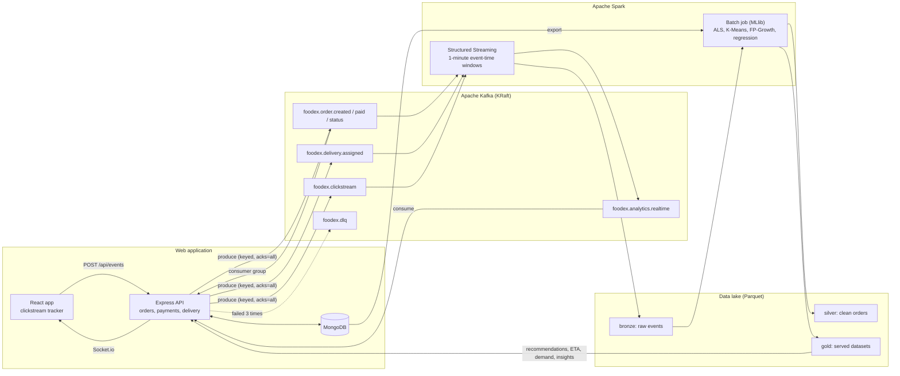

# Foodex

Full-stack food delivery platform (React, Node.js, MongoDB) with an event-driven
big data pipeline behind it: **Apache Kafka** for event streaming, **Apache Spark**
(Structured Streaming and MLlib) for real-time and batch analytics, and a
bronze/silver/gold data lake.

## Architecture



How the pieces are used:

| Layer | What it does here | Code |
|---|---|---|
| **Kafka producers** | Every order, payment, status change, delivery assignment and browser click is published as a versioned JSON event, keyed by order or session so related events stay in order on one partition | `backend/src/kafka/`, `backend/src/services/orderService.js`, `frontend/src/services/tracker.js` |
| **Kafka consumers** | A consumer group sends notifications and assigns delivery partners. Handlers are retried, poison messages go to a dead-letter topic, and redelivered events are dropped by event id (at-least-once delivery with idempotent consumers) | `backend/src/kafka/index.js`, `eventHandlers.js` |
| **Spark Structured Streaming** | Reads the topics, aggregates orders, revenue, trending dishes and funnel stages in 1-minute event-time windows with a watermark, and publishes the results back to Kafka; also lands every raw event in the lake as Parquet | `backend/analytics/streaming_pipeline.py` |
| **Live dashboard** | The API consumes Spark's windows and pushes them to the admin page over Socket.io | `backend/src/services/realtimeMetricsService.js`, `frontend/src/pages/AdminPipelinePage.jsx` |
| **Spark batch + MLlib** | Cleans orders into a silver table, then builds ALS recommendations, K-Means customer segments (RFM), FP-Growth basket rules, a delivery-time regression and a demand forecast | `backend/analytics/batch_features.py` |
| **Serving** | The API reads the gold datasets: personalised restaurants on the home page, delivery ETA at checkout, demand per restaurant, and the insights section of the admin page | `backend/src/services/sparkOutputStore.js`, `analyticsService.js` |

The application does not depend on the pipeline being up. Without a broker,
events are dispatched to the same handlers inside the API process; without
Spark output, the analytics endpoints fall back to MongoDB aggregates. The admin
page states which path is active, so a number is never attributed to Spark when
Spark did not produce it.

## Tech stack

- **Frontend:** React 19, Vite, Tailwind CSS, Redux Toolkit, Recharts, Socket.io client
- **Backend:** Node.js, Express 5, Mongoose, Socket.io, GraphQL (Apollo), JWT auth, Bull queues
- **Streaming:** Apache Kafka 3.9 (KRaft), kafkajs
- **Processing:** Apache Spark 3.5 (PySpark): Structured Streaming, Spark SQL, MLlib
- **Storage:** MongoDB (operational), Parquet data lake (analytical)
- **Other:** Razorpay payments, Gemini AI ordering assistant, Docker Compose, GitHub Actions

## Quick start (app only)

1. Start MongoDB locally.
2. Backend:
   ```bash
   cd backend
   npm install
   cp .env.example .env   # fill in the values you need
   npm run seed:demo
   npm run dev
   ```
3. Frontend:
   ```bash
   cd frontend
   npm install
   npm run dev
   ```

Frontend: http://localhost:5173. Backend: http://localhost:5000.
Demo admin: `admin@foodex.com` / `admin123` (created by the seed script).

Sign in as the admin and open **Admin → Open data pipeline** (`/admin/pipeline`).
With nothing else running it shows the in-process fallback; **Send traffic**
publishes simulated sessions and orders so you can watch the live charts.

## Running the data pipeline (Kafka + Spark)

Requires Docker Desktop with about 6 GB of memory available to it.

1. Start Kafka, Kafka UI, the Spark cluster and the streaming job:
   ```bash
   docker compose up -d --build
   ```
   The first start downloads the Spark Kafka connector, so it needs internet access.

2. Point the API at the broker. In `backend/.env`:
   ```
   KAFKA_ENABLED=true
   KAFKA_BROKERS=localhost:9092
   ```
   Restart the API. The log should say `Kafka connected (localhost:9092): 8 topics ready`.

3. Generate traffic, from the admin page or from the command line:
   ```bash
   cd backend
   npm run kafka:load -- --orders 20000
   ```
   On `/admin/pipeline` the Kafka stage shows **Connected**, the stream
   processing stage shows **Spark Structured Streaming**, and the topic table
   fills in partitions, broker message counts and consumer lag.

4. Build the batch features:
   ```bash
   cd backend
   npm run analytics:export
   python analytics/generate_orders.py --orders 200000 --catalog analytics/data/catalog.json --out analytics/data/synthetic
   cd ..
   docker compose --profile batch up spark-batch
   ```
   `analytics:export` writes the real orders and catalogue from MongoDB.
   `generate_orders.py` adds synthetic orders that reference the same
   restaurants, because a demo database is far too small to train on; the run
   is labelled `synthetic` in the UI. Reload the insights section of the admin
   page when the job finishes.

| UI | URL |
|---|---|
| Kafka UI (topics, messages, consumer groups) | http://localhost:8080 |
| Spark master | http://localhost:8081 |
| Spark worker | http://localhost:8082 |

More detail on the jobs, their inputs and outputs: [backend/analytics/README.md](backend/analytics/README.md).

## Tests

```bash
cd backend && npm test                              # API, event bus (Kafka client mocked), Spark output serving
cd frontend && npm test
cd backend/analytics && python -m pytest tests      # generator; Spark tests need Java 17 and pyspark
```

CI (`.github/workflows/ci-cd.yml`) additionally runs the Spark tests and the
batch job end to end on generated data, and the event bus against a real Kafka
broker.

## Application features

- JWT authentication and role-based access control (customer, restaurant owner, delivery partner, admin)
- Restaurant and menu browsing, cart, checkout, order history, group orders
- Real-time order tracking with status timeline and Socket.io updates
- Razorpay payment order and verification flow, admin payments dashboard
- Restaurant owner dashboard, menu management, invoices
- Gemini-powered AI order box with database-backed recommendations
- Admin analytics, and the data pipeline page described above

## Describing this project on a resume

These describe what the code does. Fill in the bracketed numbers from your own
runs (the admin page, Kafka UI and the Spark job's `_manifest.json` report
them), and only claim what you have run yourself.

- Built an event-driven food delivery platform (React, Node.js, MongoDB) that publishes order, payment, delivery and clickstream events to **Apache Kafka** topics, keyed by order and session, with consumer-group processing, retries, a dead-letter topic and idempotent handlers for at-least-once delivery.
- Implemented a **Spark Structured Streaming** job that aggregates Kafka events in 1-minute event-time windows with watermarking and feeds a live admin dashboard through Kafka and Socket.io, while landing raw events in a Parquet data lake.
- Developed a **PySpark MLlib** batch pipeline over [N] orders: ALS collaborative filtering for restaurant recommendations, K-Means customer segmentation on RFM features, FP-Growth association rules, and a delivery-time regression (RMSE [x] min) whose coefficients the Node API serves without a Spark runtime.
- Designed a bronze/silver/gold data lake and a serving layer with automatic fallback to MongoDB aggregates, so the application keeps working when the pipeline is offline.
- Containerised Kafka (KRaft) and a Spark standalone cluster with Docker Compose, and added CI that runs the Spark jobs on generated data and tests the event bus against a real broker.
